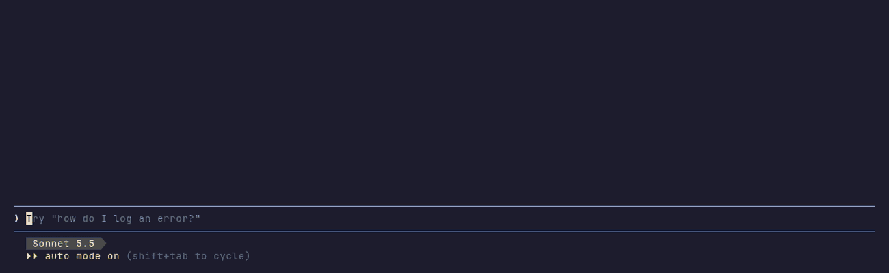

# jungle-run

A flip-screen jungle run in a band above your Claude Code prompt. Every tool call Claude makes lays the next screen's hazard, and a little explorer crosses it on autopilot. You just watch. There's nothing to play.



*`/jungle demo`: one screen of every hazard, from a single log to the fire.*

It's drawn in the style of the early 80s home console jungle games: flat bands of canopy, jungle and dirt, black tar pits, swinging vines, crocodile heads in a pond. Every pixel is our own.

## What it shows

| Happening in Claude Code | On the next screen |
|---|---|
| `Read` | A log to hop |
| `Edit`, `Write` | Logs rolling at him |
| `Bash` | A tar pit to jump |
| `Bash` running tests, a build or an install, or in the background | Quicksand that opens and closes, so he has to time it |
| `Grep`, `Glob`, a subagent | A pit with a vine to swing across |
| `WebFetch`, `WebSearch` | A pond of three crocodiles to cross on their heads |
| An MCP tool | A pond with two crocodiles |
| A call that fails or is refused | Fire |
| A new task (`TaskCreate` or `TodoWrite`) | He stops to mark it on his map |
| A task finished | Treasure lies on the ground, and he holds it up when he gets there |
| A permission dialog opens | A red `!` beside his hat and a red caption |
| The turn ends | He makes camp by a fire |

The caption under the band names the file, pattern, command or host the call was about. With a task list, a tally shows how many are done and what's next. A finished task only counts once he has picked up its treasure.

At camp he waves, wipes his brow, reads the map or looks back down the trail. After 20 seconds he sits and pokes the fire, after 75 he dozes, and after 3 minutes the band hides until your next prompt.

## Terminal support

The art is drawn in octants: Unicode 16 block characters that split each cell into 2x4 pixels. Your terminal or font has to draw them.

- **kitty** draws them itself, no font needed (tested on 0.49).
- **Other terminals** need a font with the Symbols for Legacy Computing Supplement block (U+1CD00). GNU Unifont 18 has it and works as a fallback font. Without one the explorer shows up as boxes.
- The band needs about 10 free rows above the prompt. In a shorter window it stays hidden.

## Install

Needs a Claude Code build with mods (function hooks). Built and tested on 2.1.304. Run `claude --version` to see yours.

```sh
claude plugin marketplace add plaxagoras/jungle-run
claude plugin install jungle-run@jungle-run
```

Start a new session, then run `/jungle demo`.

To try it for one session without installing:

```sh
git clone https://github.com/plaxagoras/jungle-run
claude --plugin-dir ./jungle-run
```

It draws in the same spot above the prompt as other band mods (clawd-tales, for one), so run one at a time.

## Commands

| Command | What it does |
|---|---|
| `/jungle on` | Wakes the run for this session |
| `/jungle off` | Hides it |
| `/jungle demo` | One screen of every hazard |

Every session starts off, so you choose per session whether it runs.

## How it works

- It's a plugin of function hooks. It listens to `tool.call`, `turn.start`, `turn.complete`, `classic.PermissionRequest` and the task events, and draws with `ui.render` on the AbovePrompt band.
- Each tool call queues a screen. Screens are seeded, so the same seed always grows the same trees.
- Nobody scripted his moves per hazard. On each screen a breadth first search over run, wait, jump and swing finds the quickest way to the exit, tick by tick, so he never lands in a pit or on a log. Rolling logs and quicksand move on a clock, which is why he sometimes stops and waits.
- Nothing calls a model, so it costs no tokens.

## Editing the art

The explorer's body frames come from `tools/rig.py`, and everything else is drawn by hand in `art/frames.txt`. Rebuild with `python3 -I tools/build.py` (Pillow is only needed for the preview image). Tests: `claude plugin test .`

## License

MIT. See [LICENSE](LICENSE).
